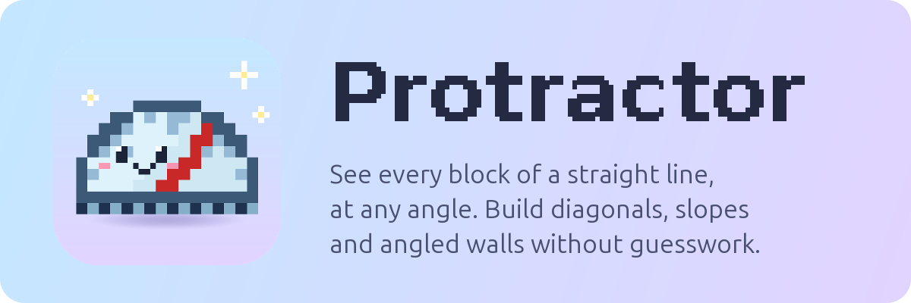
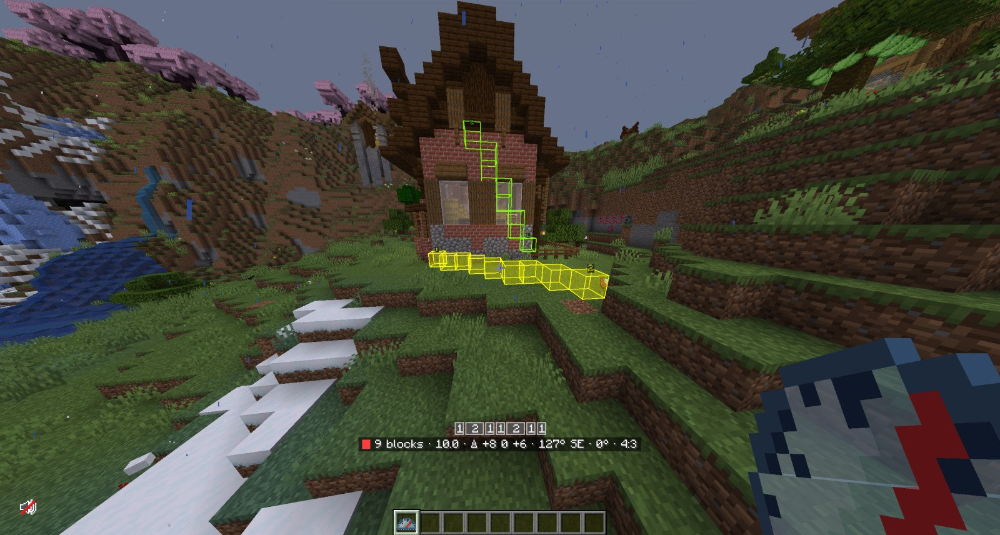
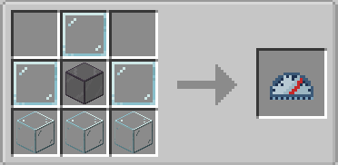

<h1 align="center">
  
</h1>

<p align="center">
  <a href="https://github.com/LyleClassen/protractor/actions/workflows/build.yml"></a>
  <a href="https://www.curseforge.com/minecraft/mc-mods/protractor"></a>
  
  
  <a href="LICENSE"></a>
</p>

A NeoForge mod for Minecraft 1.21.1, made with All The Mods 10 in mind, that helps you build at angles.

Mods like [Measurements](https://github.com/Mrbysco/Measurements) show the
distance between two points along the N/S/E/W axes. Protractor goes
further: pick any two points and it shows you exactly which blocks make up
the line between them, at any angle in any direction, so you can build
diagonals, slopes and angled walls without guesswork.

<p align="center">
  
</p>
<p align="center"><em>Two saved Lines, one along the ground and one up a wall. The Measurement above the hotbar shows the Target's block count, distance, deltas, bearing, elevation and ratio.</em></p>

## Download

Get the jar from [GitHub Releases](https://github.com/LyleClassen/protractor/releases) and drop it into your `mods` folder.

Protractor adds an item, so **on multiplayer it must be installed on the server as well as on every client**. Singleplayer needs nothing extra.

## How to use it

Craft a **Protractor** from three glass panes in an arc over a tinted glass, on a row of three glass:

<p align="center">
  
</p>

| Action | What it does |
| --- | --- |
| **Right-click** a block | Sets the first Anchor. A white preview follows your crosshair. Right-click again to set the second Anchor and save the Line. |
| **Sneak + right-click** | Cancels a pending first Anchor, or deletes the Line you're looking at (the Target). |
| **Sneak + double right-click** | Clears every Line in the current dimension. |
| Hold **Snap** (`Left Alt`) | Moves the second Anchor onto whole-block ratios (1:1, 2:1, 3:2, …). |
| **Hide** (unbound by default) | Hides and shows saved Lines. Rebind it in Controls → Protractor. |

### Features

- A Line's blocks (a thin 3D line) are drawn as outlines. Positions that are already built are hidden, so you see only what's left to place.
- The Measurement above the hotbar shows the block count, blocks left, distance, deltas, compass bearing, elevation, the X:Y:Z ratio, and a ruler of Runs.
- Lines are saved per world or server and per dimension.

### Config

Settings live in `config/protractor.json`. It is created on first launch and read again on every world join.

| Key | Default | Meaning |
| --- | --- | --- |
| `reach` | `64` | How far away, in blocks, you can set an Anchor. |
| `drawDistance` | `64` | How far away, in blocks, Lines are drawn. |
| `linePalette` | 8 colours | The colours saved Lines cycle through, as `"#RRGGBB"`. |
| `previewColor` | `#FFFFFF` | The colour of the preview Line. |
| `targetColor` | `#FFFF00` | The colour of the Line you're looking at. |
| `snapMaxPart` | `4` | The largest number used in a Snap ratio. |

## Building from source

Requires JDK 21.

```sh
./gradlew build        # test and build the mod jar into build/libs/
./gradlew runClient    # launch a dev Minecraft client with the mod loaded
```

To regenerate the logo after changing the item texture, run `python3 tools/logo/make_logo.py`, then `java tools/logo/MakeBanner.java` to rebuild the banner.

## Contributing

Contributions are welcome! All changes go in through pull requests: fork the repo, make your change on a branch, and open a PR against `main`. Only the maintainers merge into `main`. See [CONTRIBUTING.md](CONTRIBUTING.md) for the details.

## Contributors

- [Lyle Classen](https://github.com/LyleClassen), creator and maintainer
- [Claude](https://www.anthropic.com/claude), Anthropic's AI model, which pairs with Lyle through [Claude Code](https://claude.com/claude-code) on design, code and docs. Commits it helped write carry a `Co-Authored-By: Claude` trailer.

## Acknowledgements

Protractor is inspired by [Measurements](https://github.com/Mrbysco/Measurements) by [Mrbysco](https://github.com/Mrbysco). Measurements' tape measure showed how handy it is to measure in-world, and this mod builds on that idea for angled building. Thank you to Mrbysco and the Measurements contributors.

## License

[MIT](LICENSE) © Lyle Classen
