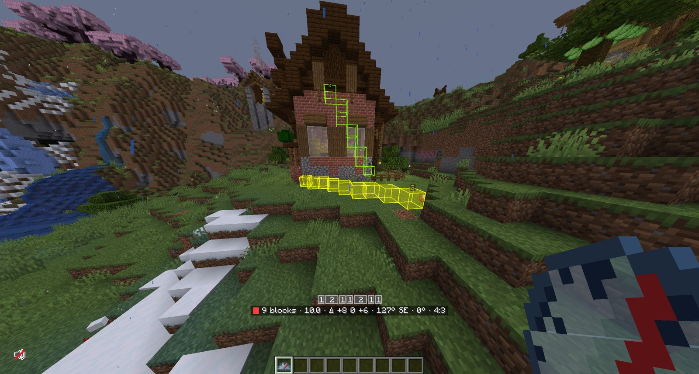
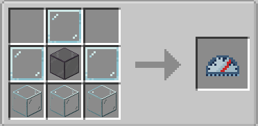

# Publishing on CurseForge

## One-time setup

1. **Create the project** at <https://authors.curseforge.com/>: Minecraft → Mods → Create Project.
   - Name: `Protractor`
   - Summary: the line under "Summary" below
   - Logo: upload [`docs/logo.png`](logo.png), which is 512×512
   - Main category: Map and Information. Extra categories: Utility & QoL, Cosmetic.
   - License: MIT
   - Source: `https://github.com/LyleClassen/protractor`. Issues: `https://github.com/LyleClassen/protractor/issues`
   - Description: paste the section below
2. **Note the Project ID** from the project page's sidebar. Add it on GitHub as a repository *variable*: Settings → Secrets and variables → Actions → Variables → `CURSEFORGE_PROJECT_ID`.
3. **Create an API token** at <https://legacy.curseforge.com/account/api-tokens>. Add it on GitHub as a repository *secret* named `CURSEFORGE_TOKEN`.
4. Optional: once the project exists, add a CurseForge badge and link to the README:
   `[](https://www.curseforge.com/minecraft/mc-mods/protractor)`

## Releasing a version

1. Set `mod_version` in `gradle.properties`.
2. Rename the `## [Unreleased]` section of `CHANGELOG.md` to `## [x.y.z] - YYYY-MM-DD`.
3. Commit, then tag and push:
   ```sh
   git tag vx.y.z
   git push origin main vx.y.z
   ```

[`.github/workflows/release.yml`](../.github/workflows/release.yml) then builds the jar and checks that the tag matches `mod_version`. It uploads the jar to CurseForge and to a GitHub Release, using that version's changelog section as the release notes. Versions with `-alpha` or `-beta` in them are published as alpha or beta files.

---

## Summary

See exactly which blocks make a straight line between any two points, at any angle. Build diagonals, slopes and angled walls without guesswork.

## Description (paste into CurseForge)

**Protractor** helps you build at angles.

Mods like Measurements show the distance between two points along the N/S/E/W axes. Protractor goes further: pick any two points and it shows you exactly which blocks make up the line between them, at any angle in any direction.



### How to use it

Craft a **Protractor**: a glass pane on top, then pane, tinted glass, pane, then three glass along the bottom.



- **Right-click** a block to set the first Anchor. A preview follows your crosshair. Right-click again to save the Line.
- **Sneak + right-click** cancels a pending Anchor, or deletes the Line you're looking at.
- **Sneak + double right-click** clears every Line in the dimension.
- Hold **Left Alt** to Snap to clean ratios such as 1:1, 2:1 and 3:2.

### Features

- Every block of the Line is outlined. Blocks you've already placed disappear from the guide, so you see only what's left.
- A HUD shows the block count, blocks left, distance, bearing, elevation, the X:Y:Z ratio and a ruler of Runs.
- Lines are saved per world or server and per dimension.
- Colours, reach and draw distance are set in `config/protractor.json`.

### Compatibility

Minecraft 1.21.1, NeoForge 21.1.x. Made with All The Mods 10 in mind. **Install it on the server as well as the client** for multiplayer.

### Credits

Inspired by [Measurements](https://github.com/Mrbysco/Measurements) by **Mrbysco**. Thank you!

Made by **Lyle Classen**, with **Claude** (Anthropic's AI model, via Claude Code) as a contributor on design, code and docs.

Source code and issues are on [GitHub](https://github.com/LyleClassen/protractor), under the MIT License. Contributions are welcome as pull requests.
